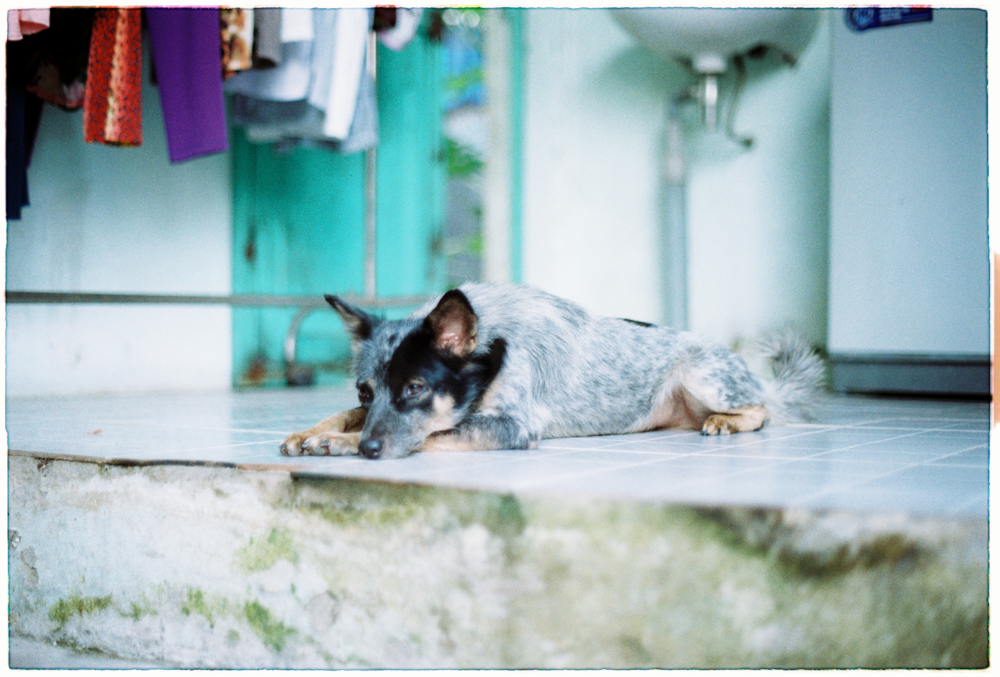
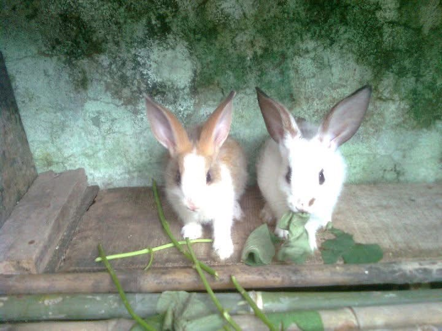
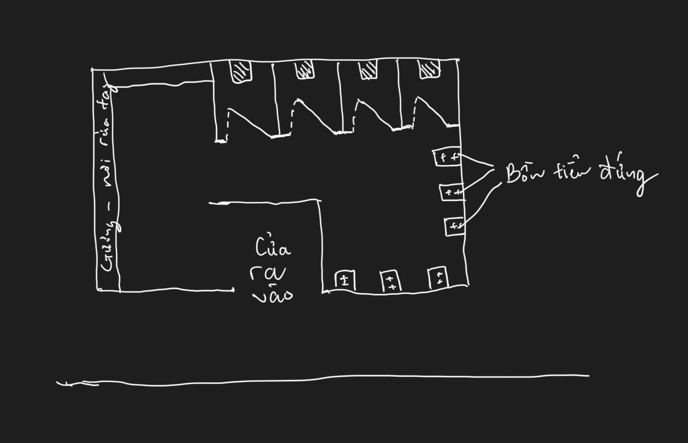

### Q1 — Ký ức đầu tiên của bạn là gì? · `[M]` · **Bắt buộc**

Kí ức đầu tiên mà tôi có thể nhớ được có lẽ là việc tôi được mẹ bế đặt vào bên trong một cái lu (lúc đó chắc tầm 2-3 tuổi), vị trí cái lu được đặt ở đường dẫn xuống bến sông trước nhà của tôi, cái lu lúc đó không có chứa nước và hoàn toàn khô ráo, tôi vẫn nhớ mang máng cái cảm giác thích thú khi lần đầu được ngồi vào trong đó, chiều rộng cái lu nhỏ hơn sải tay của tôi 1 xíu và thấp hơn tôi một cái đầu, tôi nhớ mình vừa đứng tay vừa vịn vào miệng lu vừa vui cười với mẹ  bên ngoài đang quan sát tôi, cảm giác như tôi vừa tìm thấy một món đồ chơi mới vậy. Sau này khi lớn, có lần mẹ tôi kể về việc cho tôi vào lu, mẹ nói đó là hình phạt vì lúc đó tôi quậy quá, không bao giờ chịu ngồi yên một chỗ nên để tôi vào lu cho tôi khỏi phải bò lung tung, nhưng tôi cảm giác lúc đó giống như là phần thưởng hơn bị phạt.

---

### Q2 — Tên con thú cưng bạn thích nhất, và những tên khác bạn muốn đặt · `[N, M]`

Tên con vậy mà tôi thích nhất là Luốc, Luốc là tên con chó mà nhà tôi nuôi được lâu nhất (khoảng 15 năm), Luốc được lấy từ "lem luốc", do màu lông của nó hơi đặc biệt, đó là sự pha trộn của 3 màu đen, trắng, xám, nhìn nó giống như được đẻ ra từ bếp củi ở nhà tôi vậy

Tôi không có một cái tên cụ thể nào khác mà mình muốn đặt, thường thì tôi sẽ thích đặt tên các con vật theo đặc điểm bề ngoài của chúng, hoặc một sự kiện ý nghĩa liên quan, giống như lúc nhà tôi có nuôi 1 cặp thỏ, 1 đực 1 cái, con đực tôi đặt tên là Nini, con cái tên là Nana, 2 cái tên được lấy theo hai chữ cái trong tên của tôi và tên của crush lúc đó

---

### Q3 — Bạn có đặt tên cho đồ vật mình sở hữu không? Liệt kê một số tên. · `[N]`

Có, đối với các thiết bị điện tử thường có thể kết nối với nhau qua bluetooth thì tôi thích đặt tên bắt đầu bằng "M" đễ lúc kết nối dễ dàng tìm đúng thiết bị của mình, vd: MPhone, MBook, MPad, MPods. Khi chơi những game như nông trại mà có đặt tên cho vật nuôi thì tôi sẽ dùng tên người thân để đặt cho chúng.

---

### Q5 — Lần cuối bạn bỏ quên một món đồ là khi nào? Đồ gì? · `[M, O]` · **Bắt buộc**

Tôi từng để quên điện thoại trên chuyến xe giường nằm về quê, khoảng khắc nhận ra là ngay lúc tôi chuẩn bị lên xe trung chuyển, may mắn là tôi kịp thời quay trở lại xe giường nằm và tìm lại được điện thoại, sau lần đó tôi nhận ra một vài cái quần của mình có túi hơi rộng, nên khi để điện thoại vào và nằm thì điện thoại dễ tuột ra ngoài mà mình không biết, có thể do lúc đó ngủ say trên xe và khi tới nơi thì lại hấp tấp xuống xe mà quên kiểm tra kĩ, sau đó tôi quyết định tìm mua 1 cái túi đeo chéo nhỏ để đựng điện thoại và ví tiền, không sợ bị vướng víu như khi để trong túi quần nhỏ và cũng tránh tình trạng điện thoại bị tuột rơi đối với những túi quần rộng

---

### Q7 — Vị trí ngồi nào tốt nhất trên xe buýt? · `[O, G]`

Đối với độ tuổi và sức khoẻ của tôi thì hàng ghế kế cuối hoặc cuối cùng ở xe buýt là ổn nhất, tôi luôn chọn những hàng cuối trên xe buýt để ngồi trước, nhường những vị trí gần cửa để cho những người khuyết tật, người lớn tuổi, trẻ em, phụ nữ dễ dàng ngồi vào nhất khi họ lên xe. Khi xe buýt không còn chỗ nào khác thì tôi mới ngồi vào những ghế ưu tiên, nhưng luôn luôn nhường chỗ cho những người ưu tiên khác khi họ lên xe. Tôi thấy những xe buýt hiện tại trong nội thành thành phố Hồ Chí Minh cũng khá nhỏ gọn, không có quá nhiều hàng ghế, và vị trí cửa xuống xe cũng được thiết kế ở giữa, nên việc chọn vị trí chỗ ngồi theo quảng đường đi xa hay gần cũng không quá quan trọng, điều quan trọng hơn là đảm bảo cho những người xung quanh dùng ghế thuận tiện nhất có thể

---

### Q9 — Thiết kế cánh cửa ra vào tốt nhất cho nhà vệ sinh Nam công cộng (mall / văn phòng / nhiều người dùng chung) · `[O, D]`

Phương án thiết kết của ra vào nhà vệ sinh nam ở nơi công cộng mà tôi chọn là hành lang chữ Z không có cửa
 - Ràng buộc: kiểu thiết kế không cửa này thích hợp cho những nơi to, có nhiều diện tích để làm nhà vệ sinh đủ rộng, đối với những văn phòng nhỏ thì kiểu thiết kế này không khả thi lắm
 - Vệ sinh: vì không cửa nên người dùng không cần dùng tay/chân để mở cửa nên đảm bảo vấn đề vệ sinh, ngăn chặn lây nhiễm tốt
 - Riêng tư: ở mức vừa phải, do không có cửa, nhưng chúng ta sẽ thiết kế lối đi hình chữ Z, ở bên hông tường ngay lối đi chúng ta sẽ đặt gương và bồn rửa tay, để có thể tăng cường sự riêng tư lên một xíu, vừa có thể tiết kiệm thêm 1 phần diện tích
 - Âm thanh: vì không có cửa nên vấn đề âm thanh có thể hơi ồn hơn những phương án có cửa khác, có thế giảm thiểu bằng cách sử dụng các vật liệu hấp thụ âm thanh để làm vách ngăn
 - Kiểm soát mùi: theo tôi phương án không cửa giúp kiểm soát mùi tốt nhất, do không khí sẽ dễ dàng lưu thông hơn, bên cạnh đó nhà vệ sinh đượt đặt mở mall / văn phhòng, nên hệ thống thông khí ở những nơi này sẽ hoạt động tốt hơn và đồng thời cũng sẽ có các anh chị cleaner dọn vệ sinh định kì, nên vấn đề mùi hôi sẽ được hạn chế đáng kể
 - Khả năng tiếp cận: Phương pháp không cửa là một lợi thế để giúp những người khuyết tật, đi xe lăn dễ dàng đi ra vào và sử dụng nhà vệ sinh hơn, phương án cửa cảm biến có thể giải quyết vấn đề này nhưng phải tốn nhiều chi phí xây dựng và bảo trì hơn phương án không cửa. Đồng thời phương án không cửa còn hạn chế việc xảy ra va chạm giữ người đi vào và đi ra nếu dùng cửa bản lề, an toàn cho người dùng hơn.
 - Chi phí, bảo trì: lợi thế lớn nhất của phương án không cửa là không tốn chi phí xây dựng và bảo chì hệ thống cửa

